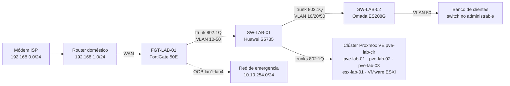

# EICL — Homelab de redes, virtualización y nube

> Laboratorio personal construido con equipo empresarial real, documentado como un proyecto de infraestructura profesional: diseño, implementación, validación con evidencias y control de cambios.

**Autor:** Carlos Eduardo Abundis Lira · **Estado:** en curso (LAB-000 a LAB-002 completados; siguiente: LAB-003) · **Inicio:** octubre 2026

*English summary: a hands-on enterprise homelab (FortiGate firewall, Huawei and TP-Link Omada switches, a three-node Proxmox VE cluster and VMware ESXi) documented end to end — design decisions, VLAN segmentation, firewall policies, test evidence and sanitized configurations. Documentation is in Spanish.*

---

## Qué demuestra este repositorio

| Área | Evidencia en el proyecto |
|---|---|
| **Diseño de red** | Plan de direccionamiento 10.10.0.0/16 con el tercer octeto igual al ID de VLAN; segmentación en gestión, servidores, monitoreo, DMZ y laboratorio |
| **Firewall (FortiGate 50E)** | Router-on-a-stick con subinterfaces 802.1Q, DHCP por VLAN, políticas de mínimo privilegio, trusted hosts, red OOB de emergencia, NTP interno |
| **Switching (Huawei S5735)** | Trunks 802.1Q con VLAN nativa sin uso, STP con raíz definida y protección BPDU/root, SSH con ACL, SFTP para respaldos, puertos sin uso apagados |
| **Switching de acceso (Omada ES208G)** | Integración de un switch *easy managed* sin STP ni ACL, compensando sus limitaciones desde el firewall y el switch principal |
| **Virtualización (Proxmox VE y VMware ESXi)** | Clúster Proxmox de tres nodos con quórum propio, probado con un nodo apagado; un ESXi independiente; redes virtuales por VLAN (bridges *VLAN aware* y *port groups*) sobre trunks 802.1Q; una VM Linux por plataforma que sale a internet y respeta la segmentación del firewall |
| **Validación** | Pruebas de punta a punta por VLAN (DHCP, gateway, internet, aislamiento entre segmentos), repetidas desde máquinas virtuales, con resultado esperado y obtenido |
| **Atención de incidentes** | [Registro de fallas reales](incidentes/) con diagnóstico por capas, causa raíz, validación, prevención y tiempo de resolución |
| **Documentación** | Memorias técnicas en LaTeX, procedimiento de implementación, registro de decisiones (D-001…), riesgos aceptados, incidentes y lecciones aprendidas |
| **Seguridad de la información** | Norma propia de saneamiento: nada sensible se publica (credenciales, seriales, MAC, orígenes autorizados) |

---

## Topología actual (LAB-002)



| VLAN | Uso | Subred |
|---|---|---|
| 10 | Gestión (MGMT) | 10.10.10.0/24 |
| 20 | Servidores (SRV) | 10.10.20.0/24 |
| 30 | Monitoreo / SOC (MON) | 10.10.30.0/24 |
| 40 | DMZ | 10.10.40.0/24 |
| 50 | Laboratorio / clientes (LAB) | 10.10.50.0/24 |
| 999 | Nativa sin uso (solo switches) | — |

Detalle completo en [`docs/architecture.md`](docs/architecture.md) (topología lógica y de enlaces), [`docs/vlan-plan.md`](docs/vlan-plan.md), [`docs/port-mapping.md`](docs/port-mapping.md) e [`docs/implementation.md`](docs/implementation.md).

---

## Roadmap

| Etapa | Laboratorio | Estado |
|---|---|---|
| 00 | [LAB-000 – Preparación, inventario y línea base](labs/LAB-000/) | Completado |
| 01 | [LAB-001 – Infraestructura física y red base](labs/LAB-001/) | Completado |
| 02 | [LAB-002 – Proxmox y VMware](labs/LAB-002/) | Completado |
| 03 | [LAB-003 – Servicios esenciales](labs/LAB-003) | Pendiente |
| 04 | LAB-004 – Segmentación avanzada y troubleshooting | Pendiente |
| 05 | LAB-005 – Centro de monitoreo | Pendiente |
| 06 | LAB-006 – Logs y SOC básico | Pendiente |
| 07 | LAB-007 – Publicación segura y DMZ | Pendiente |
| 08 | LAB-008 – Backups y recuperación ante desastres | Pendiente |
| 09 | LAB-009 – Cloud e integración híbrida | Pendiente |
| 10 | LAB-010 – VPN | Pendiente |
| 11 | LAB-011 – Automatización | Pendiente |
| 12 | LAB-012 – Integración final | Pendiente |

---

## Atención de incidentes

Fallas reales del laboratorio, documentadas como en un área de soporte: síntoma, diagnóstico por capas, causa raíz, solución, validación y prevención.

| Indicador | Valor |
|---|---|
| Incidentes registrados | 2 (1 resuelto, 1 en curso) |
| Tiempo medio de resolución | 17 min (incidentes resueltos) |

| ID | Fecha | Síntoma | Causa raíz | Resolución | Estado |
|---|---|---|---|---|---|
| [INC-002](incidentes/INC-002-corte-electrico-general.md) | 29/10/2026 | `pve-lab-03` apagado tras un corte eléctrico; ~26 h sin servicio | Corte eléctrico general; el nodo no tiene encendido automático al volver la energía | Pendiente (encendido manual hecho) | 🔄 En curso |
| [INC-001](incidentes/INC-001-nodo-sin-enlace-fisico.md) | 27/10/2026 | Nodo Proxmox sin respuesta (`Destination Host Unreachable`) | Conector RJ45 mal insertado (capa 1) | 17 min | ✅ Resuelto |

Registro completo, método y plantilla en [`incidentes/`](incidentes/).

---

## Estructura del repositorio

```
├── docs/            Arquitectura, plan de VLAN, puertos, decisiones y validaciones
├── labs/            Una carpeta por laboratorio, con memorias (.tex) y evidencias saneadas
├── incidentes/      Registro de incidentes: síntoma, diagnóstico, causa raíz, solución y prevención
├── plantilla/       Plantilla LaTeX EICL usada en todas las memorias
├── scripts/         Verificación automática de saneamiento
└── .github/         Compilación de las memorias y verificación en cada push
```

Las memorias compiladas en PDF se publican en **[Releases](../../releases)**, una por versión (por ejemplo, `lab-001-huawei-v1.1`).

---

## Metodología

Cada laboratorio sigue el mismo ciclo:

1. **Levantamiento** del estado inicial del equipo (AS-IS).
2. **Diseño** y registro de decisiones con su justificación.
3. **Implementación** por pasos numerados, cada uno con evidencia (`E-B07`, `E-C41`…).
4. **Validación** con pruebas positivas y negativas: lo permitido funciona y lo prohibido se bloquea.
5. **Respaldo** de la configuración (en almacenamiento privado, nunca en este repositorio).
6. **Memoria técnica** versionada, con incidentes y lecciones aprendidas.

Convención de referencias: `LAB-NNN` (laboratorio) · `LAB-NNN-X` (componente) · `D-NNN` (decisión) · `V-N` (validación).

---

## Protección de la información

Todo el contenido se sanea antes de publicarse, según una norma propia: credenciales, hashes, números de serie, MAC, UUID, orígenes autorizados de administración e IP públicas **nunca** aparecen. Donde haría falta un dato protegido se usa un marcador (`<IP-PC-ADMIN>`, `<REDACTADO>`). Un script de verificación ([`scripts/check-sanitization.sh`](scripts/check-sanitization.sh)) bloquea cualquier commit que lo incumpla.

---

## Licencia

- Documentación, memorias y diagramas: [CC BY 4.0](LICENSE-DOCS.md).
- Scripts, plantilla LaTeX y configuración del repositorio: [MIT](LICENSE).
