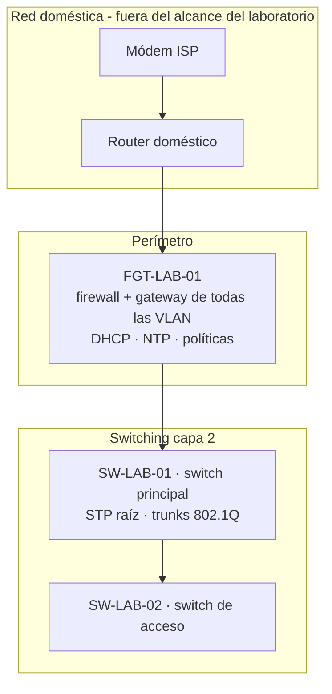

# Arquitectura

**Laboratorio:** LAB-001 · **Versión:** 1.0 · **Fecha:** 24/10/2026

## Objetivo

Construir una red de laboratorio con prácticas de entorno empresarial: segmentación por función, un único punto de control del tráfico entre segmentos, gestión aislada y acceso de emergencia independiente.

## Capas

## Principios de diseño

1. **Un solo punto de control.** Todo el tráfico entre VLAN pasa por el firewall, donde se filtra y se registra (D-002). Los switches no rutean.
2. **Gestión aislada.** Los equipos de red solo se administran desde la VLAN 10 o desde la PC de administración autorizada; el resto de segmentos no alcanza MGMT.
3. **Defensa en profundidad.** El switch principal tiene su propia ACL de administración, aunque el firewall ya filtre antes (D-008).
4. **Mínimo privilegio.** Cada acceso nuevo se agrega como política específica en lugar de ampliar una existente (D-018).
5. **Acceso de emergencia.** Una red OOB en puertos físicos dedicados del firewall permite recuperar el control si falla la red de producción (D-005).
6. **Nada transporta tráfico por defecto.** VLAN nativa sin uso (999), puertos sin uso apagados y VLAN 1 vacía o deshabilitada.

## Políticas del firewall (resumen)

| # | Nombre lógico | Origen → destino | Efecto |
|---|---|---|---|
| 1 | Bloqueo a redes domésticas | VLAN del laboratorio → 192.168.0.0/24 y 192.168.1.0/24 | Deny, con registro |
| 2 | Salida a internet | VLAN del laboratorio → WAN | Permitido con NAT (servicio pendiente de acotar en LAB-004) |
| 3 | Administración interna | MGMT → equipos y SRV | Permitido |
| 4 | Administración remota | PC de administración → MGMT (HTTPS, SSH, web de Proxmox) | Permitido, sin NAT |
| 5 | Web del switch de acceso | PC de administración → SW-LAB-02 (HTTP) | Permitido, con registro |
| — | Regla implícita | Todo lo demás | Deny |

## Limitaciones conocidas y plan

| Limitación | Se aborda en |
|---|---|
| Sin almacenamiento de logs en el firewall; registros solo en memoria | LAB-006 (syslog externo) |
| El switch de acceso no soporta SNMP, syslog ni STP | LAB-005/006 (monitoreo por ping y contadores; port mirroring para sensor) |
| Política de salida a internet con servicio amplio | LAB-004 |
| Varios niveles de NAT hacia internet | LAB-007 y LAB-010 (publicación y VPN) |
