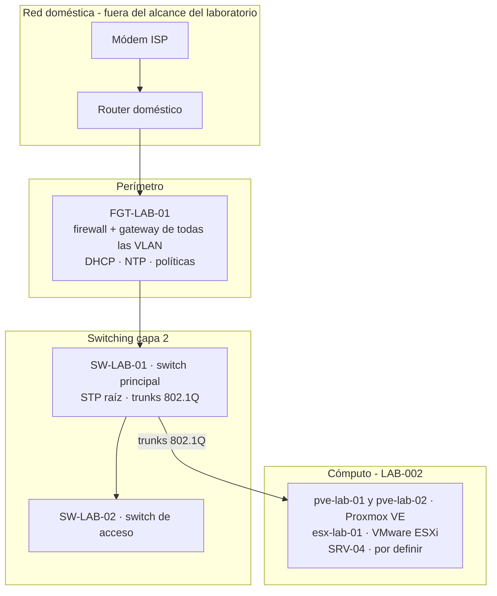
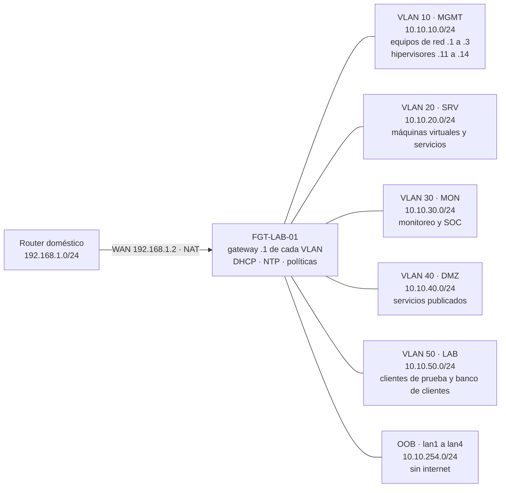
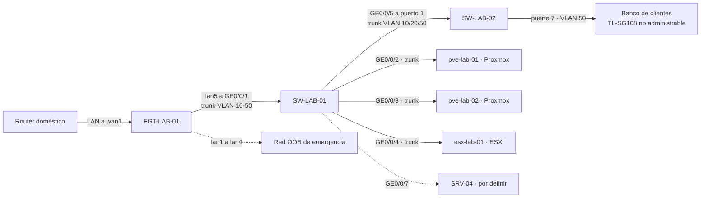

# Arquitectura

**Laboratorio:** LAB-001 · **Versión:** 1.3 · **Fecha:** 25/10/2026

## Objetivo

Construir una red de laboratorio con prácticas de entorno empresarial: segmentación por función, un único punto de control del tráfico entre segmentos, gestión aislada y acceso de emergencia independiente.

## Capas

## Topología lógica

Cada VLAN es un segmento independiente con su gateway en el firewall (`.1`). Ningún switch rutea: el tráfico entre segmentos sube por el trunk, pasa por las políticas del firewall y queda registrado (D-002).

| Segmento | Gateway | Qué vive ahí | Estado |
|---|---|---|---|
| VLAN 10 · MGMT | 10.10.10.1 | Gestión de firewall, switches e hipervisores | Activa |
| VLAN 20 · SRV | 10.10.20.1 | Máquinas virtuales y servicios internos | Activa (máquinas virtuales desde LAB-002) |
| VLAN 30 · MON | 10.10.30.1 | Monitoreo, logs y SOC | Creada, sin equipos (LAB-005/006) |
| VLAN 40 · DMZ | 10.10.40.1 | Servicios publicados | Creada, sin equipos (LAB-007) |
| VLAN 50 · LAB | 10.10.50.1 | Clientes y pruebas, incluido el banco de clientes del switch no administrable | Activa |
| OOB | 10.10.254.1 | Acceso de emergencia al firewall | Activa, sin internet |

Direccionamiento completo en [`vlan-plan.md`](vlan-plan.md).

## Topología física (enlaces)

Conexiones entre equipos, puerto a puerto. El montaje en rack, el cableado y el etiquetado están completados; su detalle físico no se publica (D-024).

Líneas punteadas: enlaces previstos o de emergencia, sin tráfico de producción hoy. El switch no administrable solo extiende la VLAN 50: no entiende VLAN ni STP, por eso cuelga de un puerto de acceso y nunca se usa para los nodos (D-026). Detalle por puerto en [`port-mapping.md`](port-mapping.md).

## Nodos de cómputo

Tres Dell OptiPlex 5070 Micro iguales: Intel Core i5-9500T (6 núcleos), 16 GB de RAM, SSD de unos 256 GB, arranque EFI y **una sola interfaz de red**. El laboratorio admite un cuarto nodo (D-025).

| Nodo | Hostname | Plataforma | Puerto en SW-LAB-01 | IP de gestión | Estado |
|---|---|---|---|---|---|
| SRV-01 | `pve-lab-01` | Proxmox VE 9.x · nodo 1 del clúster | GE0/0/2 | 10.10.10.11 | Instalado |
| SRV-02 | `pve-lab-02` | Proxmox VE 9.x · nodo 2 del clúster | GE0/0/3 | 10.10.10.12 | Instalado |
| SRV-03 | `esx-lab-01` | VMware ESXi 8.0 (versión gratuita) | GE0/0/4 | 10.10.10.13 | Instalado |
| SRV-04 | — | Por definir | GE0/0/7 | 10.10.10.14 | Previsto |

- Los puertos de los nodos son **trunk**: la VLAN 10 va sin etiqueta para la gestión del hipervisor y las VLAN 20 a 50 van etiquetadas para las máquinas virtuales (D-028). Así el ruteo y el filtrado entre máquinas virtuales de distintas VLAN siguen pasando por el firewall.
- Los tres hipervisores toman la hora del firewall (servidor NTP en la VLAN 10). Los dos Proxmox se resuelven entre sí por nombre mientras no exista DNS interno (LAB-003).

- Los nodos se conectan al **switch principal**, no al de acceso: ahí hay STP, ACL de administración y trunks gestionables (D-025).
- **Clúster Proxmox de dos nodos (D-027).** Un clúster de dos nodos no tiene quórum propio: si uno cae, el otro queda con 1 de 2 votos y bloquea los cambios. Hace falta un **tercer voto**, con un QDevice externo al clúster (por ejemplo, en SRV-04 o en una máquina virtual del nodo ESXi) o con SRV-04 como tercer nodo Proxmox. Se decide en LAB-002.
- El tráfico del clúster viaja al inicio por la VLAN 10; en LAB-012 se agrega un segundo enlace del clúster en la VLAN 70.
- La alta disponibilidad de máquinas virtuales requiere almacenamiento compartido o replicación entre los dos nodos; se evalúa con el inventario real de discos.

## Principios de diseño

1. **Un solo punto de control.** Todo el tráfico entre VLAN pasa por el firewall, donde se filtra y se registra (D-002). Los switches no rutean.
2. **Gestión aislada.** Los equipos de red solo se administran desde la VLAN 10 o desde la PC de administración autorizada; el resto de segmentos no alcanza MGMT.
3. **Defensa en profundidad.** El switch principal tiene su propia ACL de administración, aunque el firewall ya filtre antes (D-008).
4. **Mínimo privilegio.** Cada acceso nuevo se agrega como política específica en lugar de ampliar una existente (D-018).
5. **Acceso de emergencia.** Una red OOB en puertos físicos dedicados del firewall permite recuperar el control si falla la red de producción (D-005).
6. **Nada transporta tráfico por defecto.** VLAN nativa sin uso (999), puertos sin uso apagados y VLAN 1 vacía o deshabilitada.

## Políticas del firewall (resumen)

| # | Nombre lógico | Origen → destino | Efecto |
|---|---|---|---|
| 1 | Bloqueo a redes domésticas | VLAN del laboratorio → 192.168.0.0/24 y 192.168.1.0/24 | Deny, con registro |
| 2 | Salida a internet | VLAN del laboratorio → WAN | Permitido con NAT (servicio pendiente de acotar en LAB-004) |
| 3 | Administración interna | MGMT → equipos y SRV | Permitido |
| 4 | Administración remota | PC de administración → MGMT (HTTPS, SSH, web de Proxmox) | Permitido, sin NAT |
| 5 | Web del switch de acceso | PC de administración → SW-LAB-02 (HTTP) | Permitido, con registro |
| — | Regla implícita | Todo lo demás | Deny |

## Limitaciones conocidas y plan

| Limitación | Se aborda en |
|---|---|
| Sin almacenamiento de logs en el firewall; registros solo en memoria | LAB-006 (syslog externo) |
| El switch de acceso no soporta SNMP, syslog ni STP | LAB-005/006 (monitoreo por ping y contadores; port mirroring para sensor) |
| Política de salida a internet con servicio amplio | LAB-004 |
| Varios niveles de NAT hacia internet | LAB-007 y LAB-010 (publicación y VPN) |
| Una sola interfaz de red por nodo: gestión, máquinas virtuales y clúster comparten 1 Gbps | LAB-012 (segundo enlace del clúster en VLAN 70; adaptador adicional si hace falta) |
| Los puertos de los nodos llevan la VLAN de gestión sin etiqueta: un equipo conectado ahí cae en MGMT | Mitigado: puertos dentro del rack (D-028) |
| Clúster Proxmox de dos nodos sin quórum propio | LAB-002 (QDevice o tercer nodo) |
