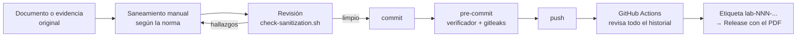

# Proceso de publicación

Ningún documento llega a este repositorio sin pasar por estos pasos. El objetivo es que publicar sea seguro por defecto, no por memoria.

## Flujo



## Lista de verificación antes de cada commit

- [ ] El documento tiene su sección «Protección de la información» (dato · tratamiento · motivo).
- [ ] Credenciales, hashes, seriales, MAC, UUID y orígenes autorizados están censurados o sustituidos por marcadores.
- [ ] Las capturas usan recuadro negro opaco (nunca desenfoque ni pixelado).
- [ ] Las fotos no conservan metadatos (`exiftool -all= foto.jpg`): las del celular incluyen la ubicación GPS.
- [ ] No hay respaldos, paquetes `.zip` ni copias de `display current-configuration` sin sanear.
- [ ] `scripts/check-sanitization.sh` termina sin hallazgos.

## Mensajes de commit

Formato: `LAB-NNN-X: descripción breve en presente`.

```
LAB-001-B: agrega memoria del Huawei v1.0
LAB-001: actualiza plan de puertos con el uplink al Omada
docs: agrega decisiones D-013 a D-018
```

## Versiones y Releases

Cada memoria publicada recibe una etiqueta con su versión; GitHub Actions la compila y crea el Release con el PDF:

```bash
git tag lab-001-huawei-v1.0
git push origin lab-001-huawei-v1.0
```

## Si algo sensible llegara a publicarse

1. Cambiar de inmediato la credencial o dato afectado en el equipo (la publicación se da por comprometida).
2. Eliminar el dato del historial con `git filter-repo` y forzar el push.
3. Registrar el incidente y la causa en el archivo de estado del proyecto.
